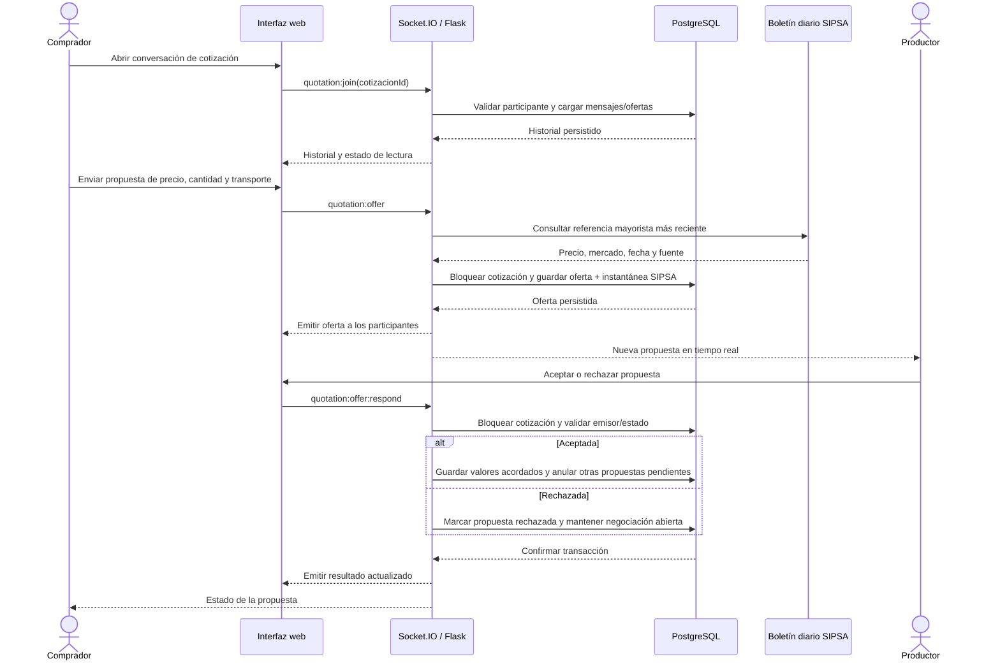

# Backend de AgroCórdoba

API Flask con SQLAlchemy. En desarrollo usa SQLite en `backend/instance/agrocordoba.db`; para alojar el proyecto debe recibir una URL PostgreSQL persistente en `DATABASE_URL`.

## Preparación local en Windows

La configuración local se centraliza en el archivo `.env` de la raíz del proyecto. Desde esa raíz, créalo si aún no existe:

```powershell
if (-not (Test-Path .env)) { Copy-Item .env.example .env }
```

Luego prepara el backend:

```powershell
cd backend
py -3.13 -m venv .venv
.\.venv\Scripts\Activate.ps1
py -m pip install -r requirements.txt
```

Configura `FLASK_SECRET_KEY` en el `.env` raíz con un secreto generado localmente. Inicia la API desde `backend`; Flask carga automáticamente la configuración raíz:

```powershell
python app.py
```

En una segunda terminal, desde la raíz, ejecuta `npm run dev`.

## Usar la base SQLite en tu PC

Al iniciar el backend local sin una variable `DATABASE_URL` configurada, AgroCórdoba guarda los registros en `backend/instance/agrocordoba.db`. Abre la página local en <http://localhost:3000> para registrar e iniciar sesión; usa siempre esta dirección local para trabajar con esa base. En tu aplicación de SQLite, abre el archivo `backend/instance/agrocordoba.db` para consultar los registros. No abras `backend/database/agrocordoba_sample.db`: ese archivo contiene datos ficticios y no es la base activa. La aplicación SQLite sirve para revisar el archivo; no conecta la página publicada de internet a tu PC.

## Rutas principales

- Sesión: `POST /api/auth/register`, `POST /api/auth/login`, `GET /api/auth/me`, `POST /api/auth/logout`.
- Contraseña: `PATCH /api/account/password` permite al usuario autenticado cambiar su contraseña local tras confirmar la contraseña actual. `POST /api/auth/password/request-code` y `POST /api/auth/password/verify-code` permiten recuperar una contraseña olvidada por correo.
- Cuenta: `DELETE /api/account` permite a clientes y productores autenticados eliminar permanentemente su perfil y datos asociados. Requiere el correo de la cuenta y escribir `ELIMINAR MI CUENTA`; para cuentas locales también exige la contraseña actual. Las cuentas Google usan la sesión autenticada.
- Perfil y configuración: `GET /api/account/settings`, `PATCH /api/account/profile`, `POST /api/account/settings/request-code`, `POST /api/account/settings/verify-code`.
- Cosechas: `GET /api/products`, `POST /api/products`, `PUT /api/products/<id>`, `DELETE /api/products/<id>`.
- Cotizaciones: `GET /api/quotations`, `POST /api/quotations`, `PATCH /api/quotations/<id>`. Se registra domicilio o recogida y una forma de pago preferida (sin procesar pagos). Para domicilio, el comprador puede capturar voluntariamente su ubicación actual una sola vez; la dirección y el pin se revelan únicamente a las partes cuando se acuerda la oferta. Para recogida, la dirección privada de la finca se comparte al comprador después del acuerdo.
- Flujo de entrega: aceptar una oferta deja el pedido en `Acordado`; el productor marca `Entregado` o `Listo para recoger`; el comprador confirma recepción y entonces pasa a `Cerrado`. Solo los pedidos `Cerrado` aparecen en el historial del comprador.
- Avisos de chat: `GET /api/notifications/unread-messages` devuelve el conteo por cotización; Socket.IO emite `quotation:unread` al recibirse o leerse mensajes. Al abrir el chat se marcan como leídos.
- Referencias de precios: `GET /api/price-references?product=Yuca` consulta el anexo diario publicado en la página oficial del [componente de precios mayoristas SIPSA del DANE](https://www.dane.gov.co/index.php/estadisticas-por-tema/agropecuario/sistema-de-informacion-de-precios-sipsa/componente-precios-mayoristas). `GET /api/price-references/batch?product=Yuca&product=Mango` permite consultar varios productos en una petición. Los precios se expresan en COP/kg, se prioriza Montería cuando está disponible y se persisten por producto, mercado y fecha. Si DANE no responde, se entrega la última referencia guardada con su fecha y fuente.
- Actualización SIPSA: `POST /api/tasks/price-references/refresh` descarga y guarda el último anexo diario, actualizando los datos del mismo día de forma idempotente. Requiere `Authorization: Bearer <SIPSA_TASK_TOKEN>` y la variable `SIPSA_TASK_TOKEN` configurada como secreto en el backend. La ruta no se programa sola: configura un planificador externo para invocarla diariamente. Si el origen falla, la actualización informa el error y las consultas públicas continúan usando los datos guardados; no se necesita reiniciar el backend.
- Conversación y negociación: Socket.IO usa `quotation:join`, `quotation:typing`, `quotation:send`, `quotation:offer` y `quotation:offer:respond`. Al entrar, se entrega el historial y se marcan como leídos los mensajes recibidos; `quotation:presence`, `quotation:typing` y `quotation:read` notifican presencia, escritura y lectura en tiempo real a la contraparte. Comprador y productor autorizados pueden enviar mensajes y ofertas con precio/kg, cantidad y transporte; cuando SIPSA tiene el dato, cada oferta conserva una instantánea de su precio, mercado, fecha y fuente. Si el boletín no incluye el producto o el servicio oficial no responde, la propuesta igualmente se guarda y el chat indica que no hay referencia disponible, sin inventar un precio. Una contraoferta reemplaza la oferta pendiente y actualiza la cotización a `En negociación`; aceptar guarda precio, cantidad, transporte y total acordados, anula las demás ofertas pendientes y marca `Acordado`; rechazar la devuelve a `En negociación`. Las operaciones de oferta bloquean la cotización en PostgreSQL para serializar contraofertas y respuestas concurrentes.
- Favoritos de compradores: `GET /api/favorites`, `PUT /api/favorites`.
- Avisos leídos de compradores: `GET /api/notifications/read`, `PUT /api/notifications/read`.
- Administración: `GET /api/admin/users`, `PATCH /api/admin/users/<id>`, `PATCH /api/admin/users/<id>/status`, `DELETE /api/admin/users/<id>`, `POST /api/admin/products`.
- Estado: `GET /api/health`.
- SEO: `GET /producto/<slug>/<id>` entrega metadatos y JSON-LD iniciales para publicaciones reales activas; `GET /sitemap.xml` lista la página principal y las publicaciones activas.

Las operaciones administrativas exigen sesión con rol `admin`. El administrador puede aprobar, editar o eliminar cuentas; eliminar una cuenta también elimina sus cotizaciones, publicaciones y preferencias asociadas. La eliminación propia sigue el mismo borrado de dependencias, limpia la sesión y no está permitida para administradores. Las publicaciones nuevas se asignan a un productor aprobado. Los productores solo pueden editar sus propios productos y gestionar sus cotizaciones. Las direcciones de entrega y recogida son datos privados: no se incluyen en el catálogo ni en perfiles públicos, y se muestran solo a las partes del pedido acordado.

## Diagrama de secuencia de negociación



## Crear administrador real

Desde `backend`, ejecuta:

```powershell
flask --app app create-admin
```

El comando solicita correo y contraseña (mínimo 12 caracteres). No guardes esa contraseña en archivos del proyecto. En una base remota, ejecuta el comando con el `DATABASE_URL` de esa base configurado localmente y conserva las credenciales fuera de Git.

En Docker Compose local, configura `ADMIN_EMAIL` y `ADMIN_PASSWORD` en el `.env` de la raíz del proyecto (no en `backend/.env`). Deben configurarse juntas y la contraseña debe tener al menos 12 caracteres. Al iniciar, se crea una cuenta administradora solo si ese correo no existe; no se modifica la contraseña de cuentas existentes. Recrea el backend con `docker compose up -d --force-recreate backend`. En despliegues sin consola disponible, configura esas variables como secretos del servicio. No guardes credenciales reales en archivos versionados.

## Correo de recuperación y confirmación

En local puedes configurar SMTP en el `.env` raíz con una contraseña de aplicación. Para un alojamiento que limite SMTP, la API admite Resend mediante HTTPS:

```env
RESEND_API_KEY=tu_clave_secreta
RESEND_FROM=AgroCórdoba <cuenta@tu-dominio-verificado.com>
```

El dominio remitente debe estar verificado en el proveedor. No compartas ni subas estas claves. Si no se configura proveedor, recuperación de contraseña y confirmación por correo responderán que el envío no está disponible.

Para habilitar recuperación de contraseñas en Render, configura `RESEND_API_KEY` y `RESEND_FROM` en las variables privadas del servicio. Por ejemplo, el remitente puede tener la forma `AgroCórdoba <no-reply@tu-dominio.com>`, pero el dominio debe estar verificado en Resend. El backend envía el correo por HTTPS. No uses una clave de ejemplo ni publiques la clave real.

La recuperación solicita un código de seis dígitos, válido durante 10 minutos. Solo se permite pedir otro código después de 60 segundos; hay hasta cinco intentos de verificación. La contraseña nueva debe tener entre 8 y 256 caracteres. El formulario y la API rechazan códigos con formato inválido; si el correo no se puede enviar, la API informa el error y no crea una verificación utilizable.

## Google OAuth

El código OAuth ya está integrado. Para que funcione con Docker Compose, configura las credenciales en el archivo `.env` de la **raíz del proyecto** (el mismo nivel que `docker-compose.yml`). Compose no carga `backend/.env`; por eso, tener valores en ese archivo no activa Google en el contenedor.

- `GOOGLE_CLIENT_ID`
- `GOOGLE_CLIENT_SECRET`
- `GOOGLE_REDIRECT_URI`
- `FRONTEND_URL`

### Desarrollo local con Docker Compose

En Google Cloud Console, configura la pantalla de consentimiento y crea un cliente OAuth de tipo **Aplicación web**. Añade estos valores autorizados:

- Origen JavaScript: `http://localhost:3000`
- URI de redireccionamiento: `http://localhost:3000/auth/google/callback`

La URI debe coincidir exactamente con `GOOGLE_REDIRECT_URI`. Si la aplicación está en modo de prueba, añade la cuenta de Google con la que vas a probar como usuario de prueba. Copia el ID de cliente y el secreto de cliente al `.env` de la raíz:

```env
GOOGLE_CLIENT_ID=el-id-de-cliente.apps.googleusercontent.com
GOOGLE_CLIENT_SECRET=el-secreto-de-cliente
GOOGLE_REDIRECT_URI=http://localhost:3000/auth/google/callback
FRONTEND_URL=http://localhost:3000/
```

Recrea el backend para que Docker reciba las variables:

```sh
docker compose up -d --force-recreate backend
```

No escribas las credenciales en el chat, el frontend, Git ni archivos compartidos. El archivo `.env` está excluido del repositorio.

### Despliegue en Render

En Google Cloud añade el origen de tu sitio, por ejemplo `https://agrocordoba.onrender.com`, y la URI `https://agrocordoba.onrender.com/auth/google/callback`. Configura `GOOGLE_CLIENT_ID`, `GOOGLE_CLIENT_SECRET`, `GOOGLE_REDIRECT_URI` y `FRONTEND_URL` como variables privadas del servicio Render. La URI configurada en Google Cloud debe coincidir exactamente con `GOOGLE_REDIRECT_URI`.

Si no se especifica `FRONTEND_URL` ni `GOOGLE_REDIRECT_URI`, el backend usa `RENDER_EXTERNAL_URL` para volver al servicio desplegado. En desarrollo sin Docker, si no se define `GOOGLE_REDIRECT_URI`, el callback predeterminado es `http://localhost:5000/auth/google/callback`.

Google inicia sesión con el correo verificado. Si ese correo ya existe en la base activa, la cuenta se asocia al identificador de Google; si no existe, se crea una cuenta nueva de cliente. Para conservar el rol administrador al cambiar a una base vacía, crea primero la cuenta administradora en PostgreSQL con `ADMIN_EMAIL` y `ADMIN_PASSWORD` usando el correo que usarás con Google, y luego inicia sesión con ese mismo correo.

Google inicia sesión con el correo verificado. Si ese correo ya existe en la base activa, la cuenta se asocia al identificador de Google; si no existe, se crea una cuenta nueva de cliente. Para conservar el rol administrador al cambiar a una base vacía, crea primero la cuenta administradora en PostgreSQL con `ADMIN_EMAIL` y `ADMIN_PASSWORD` usando el correo que usarás con Google, y luego inicia sesión con ese mismo correo.

## Base de datos y despliegue

`db.create_all()` crea las tablas nuevas al iniciar y el backend mantiene una migración sencilla de columnas de usuario heredadas. Para cambios futuros del esquema, conviene adoptar Alembic/Flask-Migrate antes de crecer. El proyecto incluye `Dockerfile` de raíz: construye Vite y sirve frontend y API desde Flask/Gunicorn en el mismo origen.

El backend de Docker ejecuta Gunicorn con el worker `gthread` y habilita el proxy WebSocket de Socket.IO en Nginx. En local, inicia el backend con `python app.py` y el frontend con `npm run dev`; Vite reenvía `/socket.io` al backend.

La instancia existente está alojada en la cuenta de Render de un compañero; estos pasos crean una instancia independiente en tu cuenta. En Render, conecta el repositorio de GitHub y crea un **Web Service** con runtime **Docker**, rama `main` y el `Dockerfile` de la raíz (`/Dockerfile`). El Dockerfile compila el frontend y ejecuta Flask/Gunicorn en el mismo origen; Render proporciona el puerto mediante `PORT`.

Crea una base **PostgreSQL** en la misma región que el Web Service y asigna su **Internal Database URL** a `DATABASE_URL` en las variables del servicio. Configura también:

- `FLASK_SECRET_KEY`: genera un secreto privado nuevo para este despliegue.
- `COOKIE_SECURE=true`.
- `FRONTEND_URL`: la URL HTTPS asignada por Render, terminada en `/`.
- `ADMIN_EMAIL` y `ADMIN_PASSWORD`: opcionales, pero recomendadas para crear el primer administrador; contraseña de al menos 12 caracteres.

No escribas secretos en Git ni en el chat. La base PostgreSQL local de Docker no se copia automáticamente a Render. Decide antes del primer despliegue si la nueva instancia empezará vacía o si necesitas respaldar y migrar datos locales. La base de la cuenta del compañero es independiente y no se modifica al crear este servicio.

Antes de confirmar la creación de recursos, revisa el plan y sus condiciones en Render. El plan gratuito de PostgreSQL tiene un límite de 30 días y no sirve como almacenamiento persistente permanente; para conservar los datos a largo plazo se necesita un plan vigente que no expire o un proveedor PostgreSQL externo.

### Importar la base fixture a PostgreSQL con Docker

`database/agrocordoba_sample.db` es una base sintética para demostración, no la base local activa ni un respaldo de datos reales. Con el servicio PostgreSQL de Compose en ejecución, desde la raíz del proyecto ejecuta:

```sh
docker compose --profile fixtures run --rm fixtures
```

La importación conserva los identificadores, las relaciones y los valores existentes; además, actualiza las secuencias de claves enteras. Para evitar mezclar datos, el comando solo acepta un destino vacío y falla si las tablas de la aplicación ya contienen registros. No elimina ni cambia el archivo SQLite original. Este procedimiento no migra `backend/instance/agrocordoba.db`; los datos de una base local real requieren una migración respaldada y revisada por separado.

Configura al desplegar:

- `DATABASE_URL`: PostgreSQL persistente; la base SQLite local no se transfiere sola.
- `FLASK_SECRET_KEY`: secreto aleatorio y privado.
- `COOKIE_SECURE=true` y `FRONTEND_URL=https://.../`.
- Credenciales OAuth y correo, solo si se van a activar.

El sistema de archivos de un Web Service no es almacenamiento de base de datos persistente. Usa PostgreSQL y verifica el despliegue en `https://<nombre-del-servicio>.onrender.com/api/health`. Después de crear una cuenta de prueba, reinicia el servicio y confirma que la cuenta sigue existiendo antes de usarlo con datos importantes.

## Archivos para la entrega de base de datos

En [`database`](database/) están el esquema SQLite (`schema.sql`), el diagrama entidad-relación (`ERD.svg` y `ERD.mmd`) y una copia de muestra (`agrocordoba_sample.db`) con datos sintéticos. Productos, certificaciones, mensajes, ofertas y referencias SIPSA diarias están normalizados en tablas relacionadas; las cotizaciones y ofertas conservan instantáneas históricas. Para crear una copia nueva, desde `backend` ejecuta:

```powershell
.\.venv\Scripts\python.exe database\create_sample_database.py
```

El generador no sobrescribe un archivo existente. La copia de muestra no proviene de Render y sus usuarios no tienen contraseñas de acceso. No reemplaza un respaldo de producción. Al iniciar, el backend migra automáticamente los campos JSON antiguos a las tablas/columnas normalizadas. Antes de migrar una base de datos con datos importantes, conserva una copia de respaldo.

## Pruebas

Las pruebas usan SQLite en memoria y una clave exclusiva de prueba. Desde `backend`:

```powershell
.\.venv\Scripts\python.exe -m pytest -q -p no:cacheprovider
```
